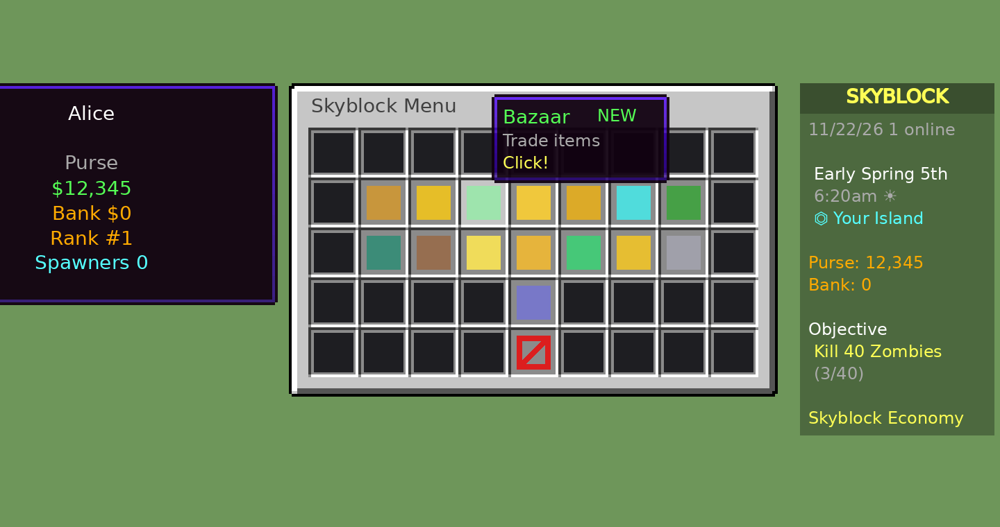
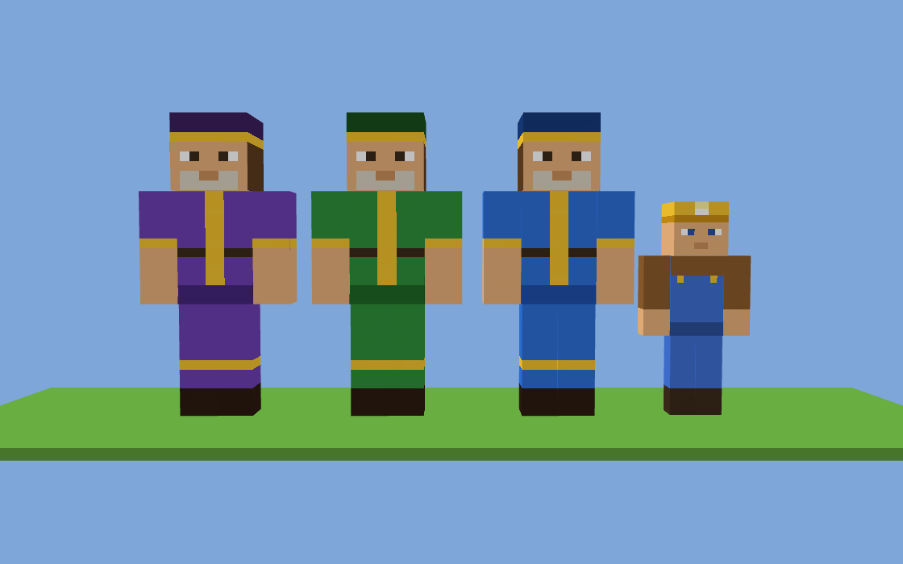
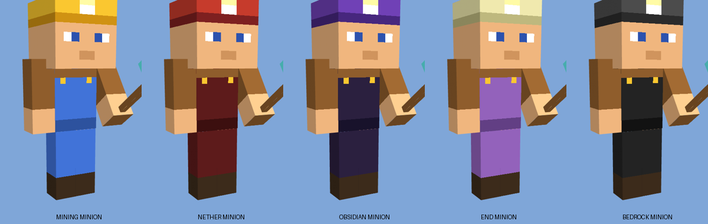

# Skyblock Economy (Minecraft Bedrock)

An economy add-on for Bedrock skyblock realms. Players use a **Menu Compass** to open
chest-style menus: a grey chest with a 9-wide grid of item slots framed by glass panes,
item tooltips on hover, and Go Back / Close / page arrows in the bottom row.


*(mock-up made from the real textures; coloured squares stand in for item icons)*

## Features

| Compass menu | What it does |
|---|---|
| **Shop** | **Every vanilla item (~1,480)**, in categories with pages, plus a **Search** button |
| **Sell** | Sell anything from your inventory, one type at a time or *Sell All* |
| **Balance** | Your money and leaderboard rank |
| **Bazaar** | Player-run market for materials: buy orders, sell offers, instant buy / sell |
| **Auction House** | List the item in your hand as BIN (Buy It Now) or as a bidding auction |
| **Bank** | Store money safely and earn interest; upgrade your account tier |
| **Profile** | Stats, Pets, Reforge, Enchanting, Wardrobe, Spirits |
| **Slayer** | Kill quests that summon a boss, slayer levels and a slayer shop |
| **Dungeons** | Party dungeon runs (Floors I-V) with classes, score grades and reward chests |
| **Quests** | 3 daily commissions plus one-time milestones |
| **Daily Reward** | Claim once a day; the streak makes it bigger |
| **Election** | Vote for the next mayor; the mayor's perks help everyone |
| **Pay** | Send money to online players |
| **Leaderboards** | Top 10 for skill average and every skill (top row), plus balance, heads collected and farming (offline players included) |
| **Player Settings** | Per-player toggles: **Sidebar**, **Chunk Borders** (particle outline of your chunk, only you see it), **Full Bright** (night vision, no particles), **Coordinates** (X / Y / Z + facing on the action bar), **Death Location** (chat message where you died), **XP Popups** and **Level-up Titles** |
| **Balance display** | Balances under $1M show exactly ($523,410); bigger ones are shortened ($2.4M, $2.4B, $7.2T) |
| **Sidebar** | Scoreboard-style panel on the right of the screen, different for every player: date, in-game season and time, location, purse, bank and your current objective. Players can switch theirs to a compact one (date, players online, purse, bank) in Player Settings; admins change the title / bottom line or turn it off in Admin > Settings > Sidebar. Uses a title with a hidden marker, drawn by `ui/hud_screen.json`, so it pauses for a moment while a level-up title shows |
| **Admin** | Only for players tagged `admin`: **Money** and **Heads** (per player), **Settings**, **Shop Editor**, **Clear Items**, **Compass** |

Shop categories: **Blocks** (Stone, Wood, Colours, Nether, The End, Decoration), **Food**,
**Kits**, **Spawners**, **Farming**, **Ores**, **Tools & Armor**, **Redstone**, **Mob Drops**,
**Brewing**, **Treasure**, **Search**.

- Balances can go up to **1 quadrillion**. They're stored on the player; the `money`
  **scoreboard** mirrors them (showing up to 2.1 billion) for the sidebar, and
  `/scoreboard players add/remove/set <name> money` commands still change the real balance.
- **Kits** have per-player cooldowns and enchantments. Includes an **Island Kit** for new islands.
- **Spawners** for 24 mobs, with stacking, upgrades, mob stacking and enchanted heads (see below).
- The compass is given on join, kept on death, and can't be dropped or stored.

## Stats & items

Every player has stats: **Health ❤, Defense ❈, Strength ❁, Crit Chance ☣, Crit Damage ☠,
Speed ✦, Intelligence ✎, Magic Find ✯, Mining Speed, Mining / Farming / Foraging Fortune,
Sea Creature Chance**. See them in **Profile > Stats**: hover a stat to see what it does in plain
words and where it comes from.

| Stat | What it does |
|---|---|
| Health | Extra hearts (Health Boost) |
| Defense | Takes `def / (def + 100)` off damage you take (100 Defense = half damage) |
| Damage / Strength / Crit | Every hit: `(hit + Damage) x (1 + Strength%)`, crits multiply by `1 + Crit Damage%`. Base Crit Chance 30%, Crit Damage 50% |
| Speed / Mining Speed | Speed and Haste effects (every 20 Speed / 25 Mining Speed is one level) |
| Intelligence | Max mana for item abilities; mana refills 2% a second |
| Magic Find | Better odds for rare slayer, dungeon and sea creature drops |
| Fortunes | Add to the matching skill's double-drop chance |

Stats come from: base, skill levels (Farming/Fishing give Health, Mining Defense, Combat
Crit Chance, Foraging Strength, Excavating Mining Speed), armor, the held weapon/tool, full
armor set bonuses, pets, slayer levels, spirits, the mayor and your dungeon class.

**Items** (`items.js`) are vanilla items with a name and lore, so they stack, trade and work on
the Auction House. Each has a **rarity** (Common, Uncommon, Rare, Epic, Legendary, Mythic) and
stats. There are about 80: shop gear (Shop > **Equipment**: custom weapons, armor and tools with stats),
slayer gear, dungeon gear and boss materials. Plain vanilla weapons, armor and tools can be
reforged and enchanted too.

- **Abilities** (right click): Blink Blade (teleport), Ember Staff / Spirit Staff (fire bolt),
  Mending Wand (heal the party), Quake Hammer (shockwave), Voidedge (teleport + Strength),
  Kingsbane (+100 Strength). They cost mana; your mana shows while you hold one.
- **Reforge** (Profile > Reforge): pick a weapon, armor piece or tool from your inventory (the
  menu lists everything that can be reforged) and get a random reforge. 14 reforges for weapons,
  armor and tools. Bigger rarity = bigger stats and price.
- **Enchanting** (Profile > Enchanting): pick an item from your inventory; 18 custom enchantments. Weapons: Keen Edge, Life
  Drain, Finisher, Precision, Venom, Storm Call, Scavenger. Armor: Vitality, Bulwark, Fleetfoot,
  Insight, **Regrowth** (heals over time), **Retaliate** (hits attackers back), **Last Stand**
  (more Defense under 30% health), **Nightsight** (helmet: night vision). Tools: Harvesting,
  Swiftswing, Lure Master.
  - Every attempt has a **chance to work**: level I 90%, II 75%, III 60%, IV 45%, V 30%.
    **A failed attempt still costs** and the item doesn't change.
  - Dungeon gear (reward chest items) pays **Essence** plus some coins; everything else pays
    coins and XP levels. Armor enchantment effects add up across all the pieces you wear.
- **Tough mobs**: slayer bosses, dungeon mobs and sea creatures have a big health pool shown in
  their name (e.g. *Rotting Tyrant I 400/400❤*).

## Upgradable Kits

Main menu > **Kits** (or Shop > Kits > Upgradable Kits). Six kit lines, each levelled from 1 to
10 (**MAXED**):

| Kit | Gear | Perk per level |
|---|---|---|
| Farming | Hoe (Efficiency, Harvesting, Swiftswing, Blessed); Harvester armor from Lv 4 | +4 Farming Fortune |
| Mining | Pickaxe (Efficiency, Fortune, Swiftswing, Harvesting, Hasty/Blessed); Prospector armor from Lv 4 | +4 Mining Fortune, +3 Mining Speed |
| Foraging | Axe (Efficiency, Harvesting, Swiftswing, Blessed) | +4 Foraging Fortune, +1 Strength |
| Fishing | Rod (Luck of the Sea, Lure, Lure Master, Blessed); Angler's Rod from Lv 6 | +0.5% Sea Creature Chance, +3 Intelligence |
| Combat | Sword (Sharpness, Looting, Keen Edge, Life Drain, Precision, Finisher, Storm Call...), bow from Lv 3, full armor (Protection, Vitality, Bulwark, Sturdy/Colossal) | +3 Strength, +0.5% Crit Chance, +0.5 Magic Find |
| Dungeon | Crypt (Lv 1-3), Phantom (Lv 4-6), Sovereign (Lv 7-10) set + weapon with stars and custom enchants; Essence each claim | +3 Defense, +2 Strength, +1 Magic Find (in dungeons) |

- Every level: better material (stone > iron > diamond > netherite), higher enchantment
  levels, more custom enchantments, a reforge from level 3, higher rarity (Mythic at 10) and
  more supplies. Maxed kits get +25% on their perk.
- Claim each kit every 12 hours. Kit gear is marked **Kit item**: it can't be sold or traded
  (it can still be reforged / enchanted further).
- Upgrades cost coins (doubling each level), need a skill level (2 per level; Dungeon Kit:
  Dungeon level) and, at the top, slayer materials (Combat Lv 6-10) or Essence (Dungeon).
- **Preview** (next level) and **View Your Kit** (current level) show every item as a slot: hover to
  see its stats, enchantments and stars. Admins can set kit levels in Admin > RPG.

## Pets

**Profile > Pets** (or Shop > Pets). One pet can be active. It gives stats and a perk that grow
with its level (1-100) and rarity, and it levels up from the skill XP you earn (its own skill
full XP, others a third). Pets: Wolf, Rabbit, Bee, Silverfish, Fox, Dolphin, Allay, Bat, and
the Drakeling (rare slayer / dungeon drop). **Upgrade Rarity** for coins once it's levelled
enough. Only one pet is out at a time: summoning another puts the current one away (chat says
which). Your active pet floats next to you as a little head (the `eco:pet` entity, made by
`tools/generate_pets.py`). **To Item** turns a pet into a spawn egg to trade or auction; using it adds it back.

## Slayer

Main menu > **Slayer**. Pick a boss and tier, kill that type of mob, and the boss spawns next
to you. Beat it in 3 minutes.

| Boss | Kill | Level bonus | Ability |
|---|---|---|---|
| Rotting Tyrant | Zombies | +2 Health | Damages players nearby and heals itself |
| Brood Mother | Spiders | +2% Crit Damage | Summons Broodlings, slows you |
| Bone Colossus | Skeletons | +2 Strength | Arrow volleys |
| Void Stalker | Endermen | +5 Intelligence, +1 Defense | Teleports to you, summons Voidlings (unlocks at Rotting Tyrant 3) |

5 tiers (more health, harder hits, more XP). Slayer levels 1-9. Bosses drop materials (and rare
items); the **Slayer Shop** makes them into gear (Tyrant's Cleaver, Venom Fang, Marrow Longbow,
Voidedge...).

## Dungeons

Main menu > **Dungeons > Play**. Players within 10 blocks get an invite (party of up to 5).
The party is teleported to a dungeon built in the sky far away (x 30000+, y 200).

- Rooms in a row: monster rooms, elite rooms (a Crypt Champion), puzzle rooms (flip every
  lever) and finally the boss room. Clearing a room opens the door to the next.
- **Secret chests** in some rooms give Essence and score.
- Getting low on health "downs" you back to the room's entrance (-15 score). No breaking or
  placing blocks. Leave any time from the compass menu. 20 minute limit.
- **Floors I-V**, each needing a Dungeon level, with its own mobs, look and boss.
- **Score** = time + skill (downs) + secrets, graded S+ to D. The grade sets Dungeon XP, Essence,
  coins and the reward chests: Wooden (free), Gold and Diamond (grade A+, best odds).
- **Classes**: Warrior, Mage, Ranger, Guardian, Cleric (heals the party). Each gives stats in
  dungeons and levels up every run. Your Dungeon level adds Defense and damage in dungeons.
- **Essence** buys dungeon gear (Essence Shop) and **stars** for dungeon items (+10% stats per
  star, up to 5).
- **Reward chests** show their loot table with the chance per roll (**... Loot** tile) and,
  once opened, what you got. Each floor has better loot:
  - **Dungeon-only island tools** in 3 tiers (Floors I-II, III-IV, V): Gravebloom Hoe / Phantom
    Scythe / Sovereign Sickle, Crypt Pick / Phantom Drill / Sovereign Excavator, Rotwood Axe /
    Spectral Hatchet / Sovereign Timberaxe, Drowned / Phantom / Sovereign Rod, plus Crypt and
    Sovereign Lantern accessories. All can be starred, reforged and enchanted.
  - **Treasures** to sell (Sell menu) or auction: Ancient Coin $4k, Crypt Relic $12k, Bone Idol
    $30k (F2+), Hollow Crown Shard $70k (F3+), Ashen Ember $140k (F4+), Sovereign Jewel $350k (F5).
- Items you drop if you die in a dungeon stay there, so be careful!

## Quests, Daily Reward, Spirits, Election, Wardrobe, Sea Creatures

- **Quests**: 3 random **commissions** a day (kill mobs, mine stone, chop logs, earn skill XP):
  $10k each, $25k bonus for all 3. Plus 17 one-time **milestones** (skill levels, bank, pets,
  slayer, dungeons...).
- **Daily Reward**: claim every 12 hours (the main menu tile shows the time left); $1,000 x your
  streak (up to 30), claim within 36 hours to keep the streak. Every 7th day adds a triple-coin bonus and
  25 Essence. Miss more than 48 hours and the streak starts again.
- **Spirits**: every mob you kill in a dungeon has a 3% chance to drop a spirit (bosses 25%;
  Magic Find raises both). Every 5 can be traded in **Profile > Spirits** for +2 Health,
  +1 Defense, +1 Strength, +1 Speed forever. Admins can give spirits in Admin > RPG.
- **Election**: there's always a mayor with 2 perks (Bramble farming, Flint mining, Vex slayer,
  Sable bank & bazaar, Quill dungeons, Marlow fishing, Ember combat, Dawn daily & XP). Players
  vote for the next one from 3 candidates; terms last 3 real days.
- **Wardrobe** (Profile): 9 slots for armor sets. Tap a slot to swap what you're wearing with it.
- **Sea Creatures**: fishing has a chance (2% + Sea Creature Chance) to pull up a tough sea
  monster; better ones appear at higher Fishing levels.

## Admin > RPG (test tools)

Give any custom item or pet, set your Slayer XP, Dungeon XP and Essence, give spirits,
and end the election or pick the mayor.

## Bazaar

Main menu > **Bazaar** (or a Bazaar NPC). Products are grouped into **Farming**, **Mining**,
**Combat** (mob and animal drops, fish), **Blocks** (stone, sand, logs...) and **Enchanted** (minion loot, enchanted crops and heads, so
those can now be traded between players).

| | |
|---|---|
| **Instant Buy** | Buys from the cheapest sell offers first (1, 16, 64... or a custom amount) |
| **Instant Sell** | Sells everything you have to the highest buy orders |
| **Buy Order** | Name an amount and price; the coins are taken now and the items wait for you |
| **Sell Offer** | Name a price; the items are taken now and the coins wait for you |
| **Manage Orders** | See how full each order is, **Claim** (or Claim All) and **Cancel** for a refund |

- Prices can have one decimal ($0.5 cobblestone). The menu suggests a price that beats the
  current best one.
- An order that crosses the book fills straight away at the price that was already waiting.
- Sellers pay a 1% tax. Max 14 orders per player. Orders keep filling while you're offline.
- Settings: `BAZAAR` in `config.js` (tax, limits, every product list).

## Auction House

Main menu > **Auction House**. Press **Create** and pick an item from your inventory:

- **BIN**: fixed price, the first buyer gets it at once.
- **Auction**: players bid; each bid must beat the last one by 10%. A bid in the last minute
  adds a minute. Outbid players get their coins back straight away.
- Durations 1h to 48h. Listing fee is 1% of the price (min $10) plus a small fee for longer
  durations; 1% tax comes off the coins the seller gets.
- **Browse** by Weapons, Armor, Tools, Special (add-on items like spawners and minions) or
  Other, **Search** by name, and **Sort** by lowest/highest price, ending soon or BIN only.
- **My Auctions**: cancel a listing or claim back an item that didn't sell.
  **My Bids**: claim the items you won.
- Items keep their name, lore, enchantments and damage, so skill tools, spawners and minions
  can be sold with their levels and upgrades. The menu compass and kit items can't be listed.
- Money for offline players (sales, refunds) is paid when they next join.
- Max 10 listings per player. Settings: `AUCTION` in `config.js`.

## Bank

Main menu > **Bank** (also under Balance, or a Banker NPC). Your **purse** is your normal balance;
the bank is a separate account.

- **Deposit / Withdraw** all, half or a typed amount (`2.5k`, `10m` work). **History** shows the
  last 10 transactions.
- **Interest:** 2% every 6 real hours, up to the account's cap. Missed payouts while you're
  offline are caught up (up to 4).
- **Upgrade** the account: Basic ($10M max, $100k interest cap) > Silver > Gold > Platinum >
  Diamond ($1T max, $1B interest cap).
- Settings: `BANK` in `config.js`.

## Spawners

| | |
|---|---|
| **Place** | Place a spawner item like a block. It spins its mob and you become its owner. |
| **Stack** | Tap your spawner while holding the **same mob and level** to add it (sneak to add the whole stack). Up to 16 per block. |
| **Menu** | **Sneak and tap** your spawner to see its info, upgrade it, add heads, add spawners from your inventory, or pick it up. |
| **Mob stacking** | Spawned mobs merge into one mob with a counter (e.g. *Zombie x25*), with no limit. They stand still on their spot and don't burn in daylight. Killing it drops loot for one and the counter goes down. |
| **Enchanted heads** | Mobs from spawners can drop an **Enchanted <Mob> Head**. Selling heads (or *Add Heads* in the spawner menu) adds them to that mob's **head balance**, separate from money. |
| **Upgrades** | Spend that mob's heads to level a spawner up (1 to 10): faster spawns and a better head chance each level. Heads only upgrade spawners of the same mob, and the cost is multiplied by the stack size. |
| **Slimes & magma cubes** | Spawner slimes spawn small and magma cubes medium (the sizes that drop loot), and the pieces a stacked one splits into are removed, so they don't pile up beside the stack. |
| **Protection** | Spawners can't be mined or blown up. Only the owner (or an admin) can upgrade or pick them up. Picking up keeps the level and stack. |

Head balances are under **Balance > Heads**. Spawn speeds, head chances, upgrade costs,
stack limits and mob prices are in `SPAWNERS` / `SPAWNER_SETTINGS` in `config.js`.

## Skill tools & collections

- **Farming Hoe / Slayer Sword** (Shop > Skill Tools) are wooden tools that never break. They gain XP when used (fully grown crops /
  mob kills) and level up automatically to level 10. Levels 1-3 are free; higher levels
  also need a total Farming / Combat collection. Hoe: bonus crop drops, auto-replant from
  level 3. Sword: bonus mob drops, extra enchanted-head chance, Sharpness as it levels.
  They are kept on death.
- **Collections** (main menu): every crop and spawner mob has a counter with 5 tiers;
  each tier pays money once and adds a permanent bonus drop chance for that crop/mob.
  Hand-placed melons, pumpkins, sugar cane and cactus don't count.
- **Upgrades:** Profile > Skill Tool Upgrades (pick the tool from your inventory), or hold the
  tool, sneak and use it. Slayer Sword: Sharpness, Looting, Fire Aspect, Head Hunter (+head chance), Plunder
  (+bonus drops), paid with money **and** heads of a set mob. Farming Hoe: Harvester
  (+bonus crops), Cultivating (+XP), Fortune, Efficiency, Replenish (auto-replant at any
  level), paid with money **and** enchanted crops of a set crop.
- The Farming Hoe gains XP from breaking **any** farmable block (fully grown crops give 3x).
- **Enchanted crops:** fully grown crops have an 8% chance (+0.75% per hoe level) to drop an
  *Enchanted <Crop>*. Selling them adds them to that crop's enchanted balance
  (Collections > Enchanted). Admins can give them under Admin > Crops.
- Numbers are in `SKILL_TOOLS`, `TOOL_LEVELS`, `TOOL_UPGRADES`, `COLLECTION_TIERS`, `CROPS`
  and `MOB_DROPS` in `config.js`.

## Shop NPCs



Big shopkeepers (1.4x a player, ~2.5 blocks tall) that players tap instead of using the
compass: **Shop** (purple), **Sell** (green), **Menu** (blue), **Bazaar**, **Auction House** and
**Banker**. They turn to face the nearest
player, are invincible and can't be pushed. Admins spawn them where they stand, or remove the
nearest one, in **Admin > NPCs**.

## Minions




**Shop > Minions** sells 5 minions. Each one costs more but pays more: every minion's
cheapest block is worth more than the previous minion's best.

| Minion | Price | Mines | Each item worth |
|---|---|---|---|
| Mining | $25k | Cobblestone > Coal > Iron > Gold > Lapis > Redstone > Diamond > Emerald | $10 - ~$1,000 |
| Nether | $150k | Netherrack > Soul Sand > Quartz > Glowstone > Magma > Blaze Rod > Ancient Debris > Netherite Scrap | $1,200 - $6,000 |
| Obsidian | $2M | Obsidian > Crying Obsidian > Amethyst > Sea Lantern > Shroomlight > Sculk Catalyst > Echo Shard > Heavy Core | $7,000 - $27,000 |
| End | $10M | End Stone > Purpur > Chorus Fruit > Ender Pearl > Shulker Shell > End Crystal > Dragon's Breath > Dragon Egg | $30,000 - $110,000 |
| Bedrock | $50M | Bedrock > Reinforced Deepslate > Budding Amethyst > End Portal Frame > Spawner > Beacon > Netherite Block > Nether Star | $125,000 - $450,000 |

Upgrades cost x1 / x3 / x8 / x20 / x50 for each minion.

**Farming minions** (straw hats, swing a hoe; crops are shown as plants) match the mining
minion at the same price and value:


| Minion | Price | Farms | Each item worth |
|---|---|---|---|
| Crop | $25k | Wheat > Carrot > Potato > Beetroot > Sugar Cane > Cactus > Melon > Pumpkin | $10 - $700 |
| Nether Farm | $150k | Nether Wart > Crimson Fungus > Warped Fungus > Crimson Roots > Warped Roots > Weeping Vines > Twisting Vines > Warped Wart | $1,200 - $6,000 |
| Garden | $2M | Sweet Berries > Glow Berries > Cocoa > Bamboo > Kelp > Sea Pickle > Lily Pad > Big Dripleaf | $7,000 - $27,000 |
| Golden Harvest | $10M | Golden Carrot > Glistering Melon > Honeycomb > Honey Bottle > Pumpkin Pie > Cookie > Cake > Golden Apple | $30,000 - $110,000 |
| Mythic Grove | $50M | Torchflower > Pitcher Plant > Spore Blossom > Chorus Flower > Wither Rose > Turtle Egg > Sniffer Egg > Enchanted Golden Apple | $125,000 - $450,000 |

Place a minion on a block and it mines the block in
front of it on a loop. That block is part of the minion, so it can't be broken, blown up
or pushed. Minions keep working while you're away and catch up when the area loads,
until their storage is full.

Minions mine **Enchanted** items (Enchanted Cobblestone, Coal, Raw Iron, Raw Gold, Lapis,
Redstone, Diamond, Emerald) worth **10x** the normal sell price (`lootMultiplier`). They sell
in the minion's Sell All or the normal Sell menu, and can't be crafted.

Tap a minion (or its block) to:
- **Collect** its items or **Sell All** of them at shop prices
- **Upgrade:** Speed (faster), Luck (chance of the next tier's block), Fortune (extra
  drops), Storage (holds more), and **Better Blocks**: Cobblestone > Coal > Iron > Gold >
  Lapis > Redstone > Diamond > Emerald
- **Pick up** (keeps its upgrades and gives you its storage)

Only the owner (or an admin) can use a minion. Each minion's price, upgrade multiplier and
every tier's cost, drop amount and sell value, plus speed, storage, the per-player limit and
upgrade costs/effects, are in **Admin > Settings > Minions** (defaults: `MINION_TYPES` in
`tools/generate_assets.py` > `scripts/minion_types.js`, `MINION_SETTINGS` / `MINION_UPGRADES`
in `config.js`).

## Chunk Hopper

**Shop > Chunk Hopper** ($50k). Place it and it collects **every dropped item in its chunk**
(16x16, top to bottom) into its own storage about once a second, including whole floor-item
piles. Renamed / enchanted / special items are left alone. It's a locked hopper, so it never
moves items itself. Tap it to **Sell All** (minion items at their value; heads and enchanted
crops go to your balances), **Collect All**, **Upgrade Storage** (1,000 items + 1,000 per
level) or **Pick Up** (keeps its level). One per chunk; owner/admin only; can't be mined or
blown up. **Upgrade Speed** makes it sweep the chunk faster (every 4s down to every 0.25s).
Price, storage, speed and upgrade costs: **Admin > Settings > Chunk Hopper**.

## Skills

Main menu > **Skills**. Skills level up automatically (max 25) as you play; each level raises
the skill's perk by 2% straight away and gives a coin reward (`moneyPerLevel` x level, triple
every 5th level) that you **claim in the Skills menu** (per skill or Claim All). The main menu's
Skills tile shows how many rewards are waiting.

| Skill | XP from | Perk |
|---|---|---|
| Farming | fully grown crops | double crop chance |
| Mining | stone, cobblestone (generators), ores | double ore chance (not with Silk Touch) |
| Foraging | logs | double log chance |
| Excavating | dirt, sand, gravel, clay... | double drop chance |
| Fishing | anything caught with a rod | double catch chance |
| Combat | killing mobs | bonus mob drop chance |

**My Progress** (top of the Skills menu) shows your skill average and server rank, every
skill's XP to the next level, your 3 weakest skills with how to train them, the collections
closest to their next reward, and the next Skill Tool unlocks.

Blocks placed by players don't give XP. Tweak everything in **Admin > Settings > Skills**
(max level, XP curve, money reward, action bar, each skill's perk / XP rate / on-off) and set
players' levels in **Admin > Skills**. Defaults are `SKILLS` / `SKILL_SETTINGS` in `config.js`.

## Prices: no crafting profit

Every item has a buy price and a sell price, generated by `tools/generate_prices.py`
from Mojang's official recipe data (2,200+ crafting, smelting, smithing and brewing
recipes):

1. Raw materials (logs, ore drops, mob drops, crops) have hand-set base prices.
   Things that are scarce on a skyblock island, like dirt, sand, gravel, clay and
   saplings, cost more.
2. Everything craftable is priced from the cheapest way to make it.
3. Sell price is about **50%** of the buy price.
4. **Anti-profit check:** for every item it works out the cheapest anyone could get it for,
   by buying it or buying ingredients and crafting, through any number of steps.
   No item ever sells for more than that. Recipes, uncrafting (blocks to ingots),
   smelting, stripping logs, filling and emptying buckets, copper ageing and mining
   ores with Fortune III are all covered. **Buying items, crafting them and selling
   can never make money.**
5. Items from kits are tagged *Kit item* and can't be sold back.

Players still earn money the skyblock way: cobblestone generators, farms, mob farms,
trees and so on.

## Install

1. Run `./tools/build.sh`. It creates `dist/SkyblockEconomy_v<version>.mcaddon`
   (the version also shows in the pack names in-game).
2. Open the `.mcaddon` file to import it into Minecraft.
3. Add **both** the behaviour pack and the resource pack to your world.
4. No experimental toggles are needed (stable Script API, game 1.21.90+).
5. Realms: apply the packs to a local copy of the world, then *Replace World* on the realm.

## Commands

```
/tag <player> add admin                    give someone the Admin tile
/scoreboard players add <player> money 1000
/scoreboard objectives setdisplay sidebar money   show balances on the sidebar
/scriptevent eco:compass                   give yourself a compass
/execute as @p run scriptevent eco:menu    open the menu (e.g. from an NPC/command block)
```

## Shop Editor (in-game, no files needed)

Admins (`/tag <name> add admin`) can rearrange the shop live, even on a Realm:

- **EDIT button:** open any item in the shop and press **EDIT**.
- **Admin > Shop Editor:** search for an item, browse a category, or see hidden/edited items.

For each item you can:
- **Move** it to any category or sub-section (e.g. *Wood > Stairs*).
- **Hide** it (gone from the shop and can't be sold) or **Show** it again.
- **Price:** set its buy and sell price (sell can't be higher than buy).
- **Reset** it back to normal. *Reset All* undoes every edit.

Edits are saved in the world, so they survive restarts **and add-on updates**.

## Settings (in-game, no files needed)

**Admin > Settings** lets admins change the whole pack from inside the world:

- **Spawners > Levels:** each level's head drop chance, seconds between spawns and head
  cost to upgrade. Add or remove levels.
- **Spawners > Rules:** stack limit, mobs per spawn, activation range, mob stack limit,
  merge radius, mob stacking on/off, freeze mobs on/off, and whether the upgrade cost is
  multiplied by the stack size.
- **Spawners > Mob Prices:** each spawner's price, or hide it from the shop.
- **Kits:** edit name/price/cooldown/badge, hide, delete, **set a kit's items from your
  inventory** (enchantments and names kept), or create a **new kit** from your inventory.
- **Skill Tools:** each tool's name, price, XP per use, bonus per level, replant level /
  head bonus; every **upgrade's** money and head costs per level, which mob's heads it
  uses, its bonus and on/off; and **Tool Levels** (XP and collection needed per level).
- **Collections:** tier amounts, money rewards, bonus drop % per tier; add/remove tiers.
- **Economy:** starting money, currency symbol, items per shop page, compass on join.
- **Floor items:** dropped stackable items within a few blocks merge into one pile with a
  counter (e.g. *Bone x500*) to reduce lag. Non-stackable items are left alone. Piles give
  64 at a time when picked up and despawn after 5 minutes like normal. Turn it on/off,
  change the distance or hide the counter here. **Admin > Clear Items** removes all
  dropped items in loaded areas.
- **Reset** buttons go back to the defaults in `config.js`.

Settings are saved in the world, so they work on Realms and survive add-on updates.

## Customising

- **Kits, spawners, starting money, shop tile order:** `packs/SkyblockEconomy_BP/scripts/config.js`
- **Moving / hiding / repricing items in a file instead:** `CATEGORY_MOVES`, `DISABLED_ITEMS` and
  `PRICE_OVERRIDES` in `config.js` (the category ids are listed there).
  Overrides skip the anti-profit check, so keep sell prices below buy prices.
- **All prices / shop categories at once:** edit `BASE` / `SELL_RATIO` / `CATEGORY_RULES` in
  `tools/generate_prices.py`, then run it (it also draws the 3D shop icons for stairs, slabs,
  walls, carpets, glass, wool, concrete and terracotta with `tools/iso_icons.py`):
  ```
  git clone --depth 1 https://github.com/Mojang/bedrock-samples.git /tmp/bs
  python3 tools/generate_prices.py /tmp/bs
  ```
- **Server name above the menu:** `$eco_server_name` / `$eco_server_tag` in
  `packs/SkyblockEconomy_RP/ui/eco_form.json`
- **Colours / textures / icons:** edit `tools/generate_assets.py`, then run it (needs Pillow).
  After adding or changing item icons, run `tools/generate_icon_map.py` so menus use the same icons.

## How the custom UI works

`ui/server_form.json` replaces the action-form layout. If a form's title starts with the
hidden marker `§e§c§o§<theme>§r`, the chest layout from `ui/eco_form.json` is used.
Otherwise the vanilla one is, so other add-ons' menus are unaffected.

- `tileMenu()` in `scripts/ui.js` lays a menu's buttons out as chest slots: content in the
  middle 7 columns (up to 4 rows, 28 per page, more pages added automatically), black glass
  panes around it, and Previous / Go Back / Close / Search / Next in the bottom row.
- Hovering a slot (or focusing it with a controller) shows its name and lore in a
  tooltip. The form body (balances, descriptions) is shown in the tooltip-style box on the
  left of the chest.
- Textures: `textures/ui/eco/chest_*` (regenerate with `tools/generate_chest_ui.py`).
- The **sidebar** is sent as a title (heading, marker `§e§s§b§r`) plus a subtitle (lines);
  `ui/hud_screen.json` draws it on the right as a grey panel with a gold border (`textures/ui/eco/sidebar_bg`): date, in-game season / day / time,
  location, purse, bank, your current objective (slayer quest, dungeon run or a daily
  commission) and the footer.

## Removed from the shop

Shulker boxes, bundles, firework rockets, poisonous potatoes, honey bottles, pufferfish, bone
blocks, beehives, chipped / damaged anvils, jukeboxes, music discs, straw beds, harnesses,
brushes, horse and nautilus armor, maps, name tags, leads, (calibrated) sculk sensors, minecarts,
weighted pressure plates and shulker shells are not sold (`HIDE_EXACT` / `HIDE_RE` in
`tools/generate_prices.py`). Accessories were removed from the add-on.
