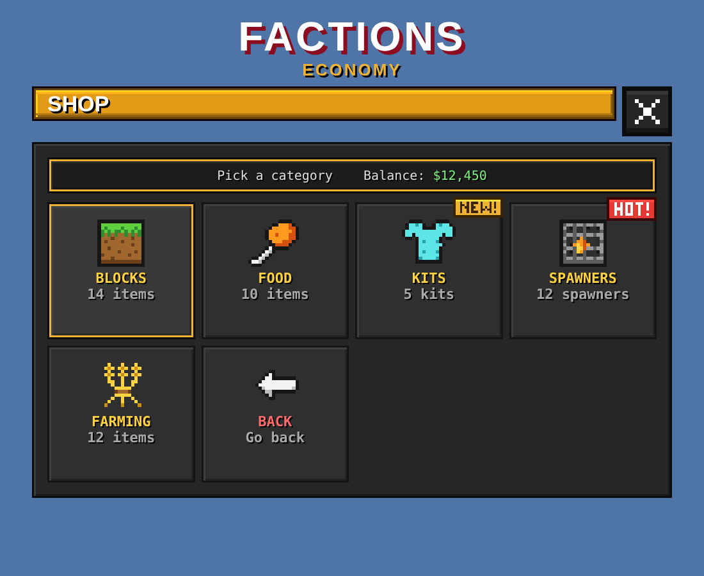
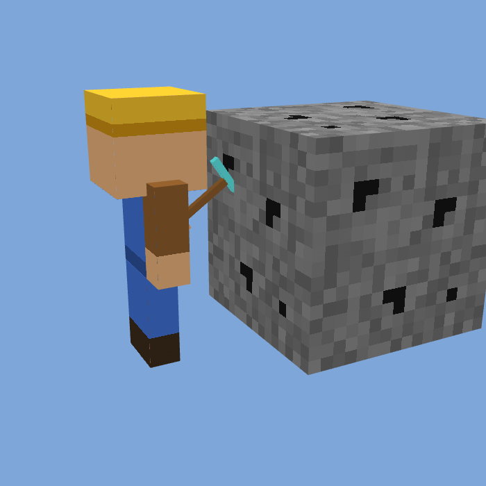
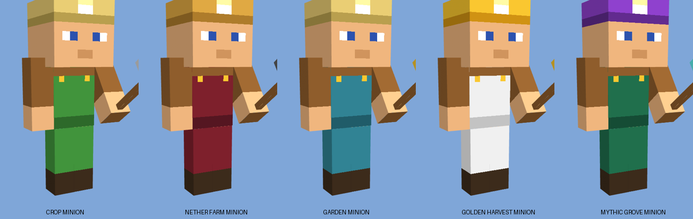

# Skyblock Economy (Minecraft Bedrock)

An economy add-on for Bedrock skyblock realms. Players use a **Menu Compass** to open
custom-styled menus: dark panels, coloured header bars, icon tiles and NEW!/HOT! badges.


*(mock-up made from the real textures)*

## Features

| Compass menu | What it does |
|---|---|
| **Shop** | **Every vanilla item (~1,480)**, in categories with pages, plus a **Search** button |
| **Sell** | Sell anything from your inventory, one type at a time or *Sell All* |
| **Balance** | Your money and leaderboard rank |
| **Pay** | Send money to online players |
| **Leaderboards** | Top 10 for balance, heads collected, farming, combat, skill average, every skill, spawners and minions (offline players included) |
| **Player Settings** | Per-player toggles: **Sidebar**, **Chunk Borders** (particle outline of your chunk, only you see it), **Full Bright** (night vision, no particles), **Coordinates** (X / Y / Z + facing on the action bar), **Death Location** (chat message where you died), **XP Popups** and **Level-up Titles** |
| **Balance display** | Balances under $1M show exactly ($523,410); bigger ones are shortened ($2.4M, $2.4B, $7.2T) |
| **Sidebar** | Scoreboard-style panel on the right of the screen, different for every player: name, balance, rank, heads, spawners and players online. Players can hide theirs in Player Settings; admins change the title / bottom line or turn it off in Admin > Settings > Sidebar. Uses a title with a hidden marker, drawn by `ui/hud_screen.json`, so it pauses for a moment while a level-up title shows |
| **Admin** | Only for players tagged `admin`: **Money** and **Heads** (per player), **Settings**, **Shop Editor**, **Clear Items**, **Compass** |

Shop categories: **Blocks** (Stone, Wood, Colours, Nether, The End, Decoration), **Food**,
**Kits**, **Spawners**, **Farming**, **Ores**, **Tools & Armor**, **Redstone**, **Mob Drops**,
**Brewing**, **Treasure**, **Search**.

- Balances can go up to **1 quadrillion**. They're stored on the player; the `money`
  **scoreboard** mirrors them (showing up to 2.1 billion) for the sidebar, and
  `/scoreboard players add/remove/set <name> money` commands still change the real balance.
- **Kits** have per-player cooldowns and enchantments. Includes an **Island Kit** for new islands.
- **Spawners** for 24 mobs, with stacking, upgrades, mob stacking and enchanted heads (see below).
- The compass is given on join, kept on death, and can't be dropped or stored.

## Spawners

| | |
|---|---|
| **Place** | Place a spawner item like a block. It spins its mob and you become its owner. |
| **Stack** | Tap your spawner while holding the **same mob and level** to add it (sneak to add the whole stack). Up to 16 per block. |
| **Menu** | **Sneak and tap** your spawner to see its info, upgrade it, add heads, add spawners from your inventory, or pick it up. |
| **Mob stacking** | Spawned mobs merge into one mob with a counter (e.g. *Zombie x25*), with no limit. They stand still on their spot and don't burn in daylight. Killing it drops loot for one and the counter goes down. |
| **Enchanted heads** | Mobs from spawners can drop an **Enchanted <Mob> Head**. Selling heads (or *Add Heads* in the spawner menu) adds them to that mob's **head balance**, separate from money. |
| **Upgrades** | Spend that mob's heads to level a spawner up (1 to 10): faster spawns and a better head chance each level. Heads only upgrade spawners of the same mob, and the cost is multiplied by the stack size. |
| **Slimes & magma cubes** | Spawner slimes spawn small and magma cubes medium (the sizes that drop loot), and the pieces a stacked one splits into are removed, so they don't pile up beside the stack. |
| **Protection** | Spawners can't be mined or blown up. Only the owner (or an admin) can upgrade or pick them up. Picking up keeps the level and stack. |

Head balances are under **Balance > Heads**. Spawn speeds, head chances, upgrade costs,
stack limits and mob prices are in `SPAWNERS` / `SPAWNER_SETTINGS` in `config.js`.

## Skill tools & collections

- **Farming Hoe / Slayer Sword** (Shop > Skill Tools) gain XP when used (fully grown crops /
  mob kills) and level up automatically to level 10. Levels 1-3 are free; higher levels
  also need a total Farming / Combat collection. Hoe: bonus crop drops, auto-replant from
  level 3. Sword: bonus mob drops, extra enchanted-head chance, Sharpness as it levels.
  They never break and are kept on death.
- **Collections** (main menu): every crop and spawner mob has a counter with 5 tiers;
  each tier pays money once and adds a permanent bonus drop chance for that crop/mob.
  Hand-placed melons, pumpkins, sugar cane and cactus don't count.
- **Upgrades:** hold a skill tool, sneak and use it to open its upgrade
  menu. Slayer Sword: Sharpness, Looting, Fire Aspect, Head Hunter (+head chance), Plunder
  (+bonus drops), paid with money **and** heads of a set mob. Farming Hoe: Harvester
  (+bonus crops), Cultivating (+XP), Fortune, Efficiency, Replenish (auto-replant at any
  level), paid with money **and** enchanted crops of a set crop.
- The Farming Hoe gains XP from breaking **any** farmable block (fully grown crops give 3x).
- **Enchanted crops:** fully grown crops have an 8% chance (+0.75% per hoe level) to drop an
  *Enchanted <Crop>*. Selling them adds them to that crop's enchanted balance
  (Collections > Enchanted). Admins can give them under Admin > Crops.
- Numbers are in `SKILL_TOOLS`, `TOOL_LEVELS`, `TOOL_UPGRADES`, `COLLECTION_TIERS`, `CROPS`
  and `MOB_DROPS` in `config.js`.

## Shop NPCs


Big shopkeepers (1.4x a player, ~2.5 blocks tall) that players tap instead of using the
compass: **Shop** (purple), **Sell** (green) and **Menu** (blue). They turn to face the nearest
player, are invincible and can't be pushed. Admins spawn them where they stand, or remove the
nearest one, in **Admin > NPCs**.

## Minions




**Shop > Minions** sells 5 minions. Each one costs more but pays more: every minion's
cheapest block is worth more than the previous minion's best.

| Minion | Price | Mines | Each item worth |
|---|---|---|---|
| Mining | $25k | Cobblestone > Coal > Iron > Gold > Lapis > Redstone > Diamond > Emerald | $10 - ~$1,000 |
| Nether | $150k | Netherrack > Soul Sand > Quartz > Glowstone > Magma > Blaze Rod > Ancient Debris > Netherite Scrap | $1,200 - $6,000 |
| Obsidian | $2M | Obsidian > Crying Obsidian > Amethyst > Sea Lantern > Shroomlight > Sculk Catalyst > Echo Shard > Heavy Core | $7,000 - $27,000 |
| End | $10M | End Stone > Purpur > Chorus Fruit > Ender Pearl > Shulker Shell > End Crystal > Dragon's Breath > Dragon Egg | $30,000 - $110,000 |
| Bedrock | $50M | Bedrock > Reinforced Deepslate > Budding Amethyst > End Portal Frame > Spawner > Beacon > Netherite Block > Nether Star | $125,000 - $450,000 |

Upgrades cost x1 / x3 / x8 / x20 / x50 for each minion.

**Farming minions** (straw hats, swing a hoe; crops are shown as plants) match the mining
minion at the same price and value:



| Minion | Price | Farms | Each item worth |
|---|---|---|---|
| Crop | $25k | Wheat > Carrot > Potato > Beetroot > Sugar Cane > Cactus > Melon > Pumpkin | $10 - $700 |
| Nether Farm | $150k | Nether Wart > Crimson Fungus > Warped Fungus > Crimson Roots > Warped Roots > Weeping Vines > Twisting Vines > Warped Wart | $1,200 - $6,000 |
| Garden | $2M | Sweet Berries > Glow Berries > Cocoa > Bamboo > Kelp > Sea Pickle > Lily Pad > Big Dripleaf | $7,000 - $27,000 |
| Golden Harvest | $10M | Golden Carrot > Glistering Melon > Honeycomb > Honey Bottle > Pumpkin Pie > Cookie > Cake > Golden Apple | $30,000 - $110,000 |
| Mythic Grove | $50M | Torchflower > Pitcher Plant > Spore Blossom > Chorus Flower > Wither Rose > Turtle Egg > Sniffer Egg > Enchanted Golden Apple | $125,000 - $450,000 |

Place a minion on a block and it mines the block in
front of it on a loop. That block is part of the minion, so it can't be broken, blown up
or pushed. Minions keep working while you're away and catch up when the area loads,
until their storage is full.

Minions mine **Enchanted** items (Enchanted Cobblestone, Coal, Raw Iron, Raw Gold, Lapis,
Redstone, Diamond, Emerald) worth **10x** the normal sell price (`lootMultiplier`). They sell
in the minion's Sell All or the normal Sell menu, and can't be crafted.

Tap a minion (or its block) to:
- **Collect** its items or **Sell All** of them at shop prices
- **Upgrade:** Speed (faster), Luck (chance of the next tier's block), Fortune (extra
  drops), Storage (holds more), and **Better Blocks**: Cobblestone > Coal > Iron > Gold >
  Lapis > Redstone > Diamond > Emerald
- **Pick up** (keeps its upgrades and gives you its storage)

Only the owner (or an admin) can use a minion. Each minion's price, upgrade multiplier and
every tier's cost, drop amount and sell value, plus speed, storage, the per-player limit and
upgrade costs/effects, are in **Admin > Settings > Minions** (defaults: `MINION_TYPES` in
`tools/generate_assets.py` > `scripts/minion_types.js`, `MINION_SETTINGS` / `MINION_UPGRADES`
in `config.js`).

## Chunk Hopper

**Shop > Chunk Hopper** ($50k). Place it and it collects **every dropped item in its chunk**
(16x16, top to bottom) into its own storage about once a second, including whole floor-item
piles. Renamed / enchanted / special items are left alone. It's a locked hopper, so it never
moves items itself. Tap it to **Sell All** (minion items at their value; heads and enchanted
crops go to your balances), **Collect All**, **Upgrade Storage** (1,000 items + 1,000 per
level) or **Pick Up** (keeps its level). One per chunk; owner/admin only; can't be mined or
blown up. **Upgrade Speed** makes it sweep the chunk faster (every 4s down to every 0.25s).
Price, storage, speed and upgrade costs: **Admin > Settings > Chunk Hopper**.

## Skills

Main menu > **Skills**. Skills level up automatically (max 25) as you play; each level pays
money (`moneyPerLevel` x level) and raises the skill's perk by 2%.

| Skill | XP from | Perk |
|---|---|---|
| Farming | fully grown crops | double crop chance |
| Mining | stone, cobblestone (generators), ores | double ore chance (not with Silk Touch) |
| Foraging | logs | double log chance |
| Excavating | dirt, sand, gravel, clay... | double drop chance |
| Fishing | anything caught with a rod | double catch chance |
| Combat | killing mobs | bonus mob drop chance |

**My Progress** (top of the Skills menu) shows your skill average and server rank, every
skill's XP to the next level, your 3 weakest skills with how to train them, the collections
closest to their next reward, and the next Skill Tool unlocks.

Blocks placed by players don't give XP. Tweak everything in **Admin > Settings > Skills**
(max level, XP curve, money reward, action bar, each skill's perk / XP rate / on-off) and set
players' levels in **Admin > Skills**. Defaults are `SKILLS` / `SKILL_SETTINGS` in `config.js`.

## Prices: no crafting profit

Every item has a buy price and a sell price, generated by `tools/generate_prices.py`
from Mojang's official recipe data (2,200+ crafting, smelting, smithing and brewing
recipes):

1. Raw materials (logs, ore drops, mob drops, crops) have hand-set base prices.
   Things that are scarce on a skyblock island, like dirt, sand, gravel, clay and
   saplings, cost more.
2. Everything craftable is priced from the cheapest way to make it.
3. Sell price is about **50%** of the buy price.
4. **Anti-profit check:** for every item it works out the cheapest anyone could get it for,
   by buying it or buying ingredients and crafting, through any number of steps.
   No item ever sells for more than that. Recipes, uncrafting (blocks to ingots),
   smelting, stripping logs, filling and emptying buckets, copper ageing and mining
   ores with Fortune III are all covered. **Buying items, crafting them and selling
   can never make money.**
5. Items from kits are tagged *Kit item* and can't be sold back.

Players still earn money the skyblock way: cobblestone generators, farms, mob farms,
trees and so on.

## Install

1. Run `./tools/build.sh`. It creates `dist/SkyblockEconomy_v<version>.mcaddon`
   (the version also shows in the pack names in-game).
2. Open the `.mcaddon` file to import it into Minecraft.
3. Add **both** the behaviour pack and the resource pack to your world.
4. No experimental toggles are needed (stable Script API, game 1.21.90+).
5. Realms: apply the packs to a local copy of the world, then *Replace World* on the realm.

## Commands

```
/tag <player> add admin                    give someone the Admin tile
/scoreboard players add <player> money 1000
/scoreboard objectives setdisplay sidebar money   show balances on the sidebar
/scriptevent eco:compass                   give yourself a compass
/execute as @p run scriptevent eco:menu    open the menu (e.g. from an NPC/command block)
```

## Shop Editor (in-game, no files needed)

Admins (`/tag <name> add admin`) can rearrange the shop live, even on a Realm:

- **EDIT button:** open any item in the shop and press **EDIT**.
- **Admin > Shop Editor:** search for an item, browse a category, or see hidden/edited items.

For each item you can:
- **Move** it to any category or sub-section (e.g. *Wood > Stairs*).
- **Hide** it (gone from the shop and can't be sold) or **Show** it again.
- **Price:** set its buy and sell price (sell can't be higher than buy).
- **Reset** it back to normal. *Reset All* undoes every edit.

Edits are saved in the world, so they survive restarts **and add-on updates**.

## Settings (in-game, no files needed)

**Admin > Settings** lets admins change the whole pack from inside the world:

- **Spawners > Levels:** each level's head drop chance, seconds between spawns and head
  cost to upgrade. Add or remove levels.
- **Spawners > Rules:** stack limit, mobs per spawn, activation range, mob stack limit,
  merge radius, mob stacking on/off, freeze mobs on/off, and whether the upgrade cost is
  multiplied by the stack size.
- **Spawners > Mob Prices:** each spawner's price, or hide it from the shop.
- **Kits:** edit name/price/cooldown/badge, hide, delete, **set a kit's items from your
  inventory** (enchantments and names kept), or create a **new kit** from your inventory.
- **Skill Tools:** each tool's name, price, XP per use, bonus per level, replant level /
  head bonus; every **upgrade's** money and head costs per level, which mob's heads it
  uses, its bonus and on/off; and **Tool Levels** (XP and collection needed per level).
- **Collections:** tier amounts, money rewards, bonus drop % per tier; add/remove tiers.
- **Economy:** starting money, currency symbol, items per shop page, compass on join.
- **Floor items:** dropped stackable items within a few blocks merge into one pile with a
  counter (e.g. *Bone x500*) to reduce lag. Non-stackable items are left alone. Piles give
  64 at a time when picked up and despawn after 5 minutes like normal. Turn it on/off,
  change the distance or hide the counter here. **Admin > Clear Items** removes all
  dropped items in loaded areas.
- **Reset** buttons go back to the defaults in `config.js`.

Settings are saved in the world, so they work on Realms and survive add-on updates.

## Customising

- **Kits, spawners, starting money, shop tile order:** `packs/SkyblockEconomy_BP/scripts/config.js`
- **Moving / hiding / repricing items in a file instead:** `CATEGORY_MOVES`, `DISABLED_ITEMS` and
  `PRICE_OVERRIDES` in `config.js` (the category ids are listed there).
  Overrides skip the anti-profit check, so keep sell prices below buy prices.
- **All prices at once:** edit `BASE` / `SELL_RATIO` in `tools/generate_prices.py`, then:
  ```
  git clone --depth 1 https://github.com/Mojang/bedrock-samples.git /tmp/bs
  python3 tools/generate_prices.py /tmp/bs
  ```
- **Server name above the menu:** `$eco_server_name` / `$eco_server_tag` in
  `packs/SkyblockEconomy_RP/ui/eco_form.json`
- **Colours / textures / icons:** edit `tools/generate_assets.py`, then run it (needs Pillow).

## How the custom UI works

`ui/server_form.json` replaces the action-form layout. If a form's title starts with the
hidden marker `§e§c§o§<theme>§r`, the custom layout from `ui/eco_form.json` is used.
Otherwise the vanilla one is, so other add-ons' menus are unaffected.
